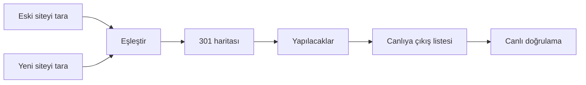

# SEO Audit

Site taşıma (yenileme) projeleri için teknik SEO aracı. Kişisel proje.

Araç iki iş yapar:

1. **Site denetimi.** Bir siteyi tarar, teknik SEO sorunlarını bulur ve her sorunu doğru ekibe verir.
2. **Taşıma projesi.** Eski siteyi ve yeni siteyi karşılaştırır, 301 listesini üretir, yapılacak işleri çıkarır, canlıya çıkışı kontrol eder ve çıkıştan sonra taşımayı canlıda doğrular.

Araç yerel bilgisayarda veya kendi sunucunuzda çalışır. Sürüm `package.json` dosyasındadır. Kararların geçmişi `CLAUDE.md` → Karar günlüğü bölümündedir.



## Araç ne yapar

### Tam yaptığı işler

Bu işlerin kodu ve testi tamamdır. Gerçek sitelerde ölçüm sürüyor (bkz. Doğrulama).

| İş | Sonuç |
|---|---|
| Siteyi tarar | Linkleri ve sitemap dosyalarını izler. Her yönlendirme adımını kaydeder. robots.txt kurallarına uyar. Şifreli staging sitesini tarar. Eski Türkçe kodlamaları (windows-1254) okur. |
| Teknik sorunları bulur | 88 kural, 15 kategori. Her sorunun açıklaması, çözümü, önemi (kritik, uyarı, bilgi) ve ekibi (Frontend, Backend, İçerik, SEO) vardır. |
| Site ayarlarını kontrol eder | http/https ve www sürümleri, SSL sertifikası, HSTS, sıkıştırma, llms.txt, kırık dış link, kırık ve büyük görsel. |
| Eski ve yeni siteyi eşleştirir | Eski sitenin her bölümü için yeni yeri önerir. Birden çok yeni siteyi destekler (örnek: diller ayrı alan adlarına gider). Sayfanın dilini kullanır. |
| 301 listesini üretir | Adresi değişen her sayfaya yeni sayfa önerir: slug, title, H1 ve içerik benzerliği, güven seviyesi ile. Siz onaylarsınız. Araç listeyi CSV olarak verir (301 ve 410). |
| 301'leri staging'de kontrol eder | Her eski adresi yeni sitede ister. Sonuç: 301 kurulu, 301 eksik, hedef yok, zincir veya geçici yönlendirme. |
| Linksiz eski sayfaları bulur | Search Console, Analytics veya backlink dışa aktarımını (CSV) ya da düz adres listesini alır. Taramada olmayan adresleri eski sitede ister. Açılan sayfa eski sayfa olur ve 301 haritasına girer. 301 haritası trafiğe göre sıralanır ("1.240 tıklama"). |
| İşleri yere ve ekibe göre ayırır | Eski alan adı sunucusu, her yeni site, içerik ve karar bekleyen işler ayrı kartlardır. |
| Canlıya çıkışı kontrol eder | Staging adresi kalmış mı (canonical, hreflang, link, görsel, sitemap, 301 listesi), staging Google'a açık mı, noindex ve `Disallow: /` nerede, Analytics/GTM ve Search Console etiketi yeni sitede var mı. |
| Taşımayı canlıda doğrular | Çıkıştan sonra her eski adresi canlı alan adında ister: 301 doğru mu, zincir, geçici yönlendirme, yanlış hedef, hedef hatalı, 410 geldi mi, kayıp sayfa. Canlı siteyi ayrıca tarar: noindex, X-Robots-Tag, `Disallow: /` ve staging adresi kalmış mı, etiketler var mı, sitemap canlı adresleri mi içeriyor ve adresler 200 mü. |
| Rapor verir | Web arayüzü, Excel (site denetimi ve taşıma projesi), 301 listesi CSV, ham JSON. |

### Kısmen yaptığı işler

| İş | Sınır |
|---|---|
| 301 önerisi | Aynı kelimeyi, ortak öneki ve yakın yazımı bulur. Farklı dildeki eş anlamı bulmaz (göz kapağı ↔ blepharoplasty). Bu sayfalarda adresi siz seçersiniz. |
| 301 listesi biçimi | Sadece CSV. `.htaccess`, nginx veya Shopify biçimi yok. |
| Etiket kontrolü | Analytics ve GTM kimliğini sadece HTML içindeki script'ten okur. Consent aracı ile yüklenen etiketi görmez. |
| Şifreli staging'de 301 kontrolü | Araç şifreyi saklamaz. Şifreli sitede bu kontrol "Kontrol edilemedi" sonucunu verir. |
| Büyük site | Varsayılan sınır 5.000 URL, en fazla 50.000. Araç bütün taramayı bellekte tutar: çok büyük sitede yavaşlar. |
| Title genişliği | Piksel değeri tahmindir. |
| Eski adres listesi | Dosya ile çalışır: Search Console ve Analytics hesabına bağlanmaz (API yok). Search Console zip dosyası açılmaz: içindeki `Pages.csv` dosyasını seçin. Sütun adları gerçek bir dışa aktarım ile henüz denenmedi: bulunamayan sütunu siz seçersiniz. Yapılacaklar ve Canlı doğrulama listeleri henüz trafiğe göre sıralanmaz. Çıkıştan sonra eklenen adres henüz kontrol edilmez. |

### Yapmadığı işler

- JavaScript çalıştırmaz. React, Next veya Vue ile oluşan içeriği ve linkleri görmez.
- Search Console, Analytics veya backlink aracına bağlanmaz (API ve hesap bağlantısı yok). Trafik verisini sadece yüklenen dosyadan okur.
- Site denetimindeki sorunları trafiğe göre sıralamaz. Sadece taşıma projesinin 301 haritası trafiğe göre sıralanır.
- Hız ölçmez (Core Web Vitals).
- Anahtar kelime ve sıralama takibi yapmaz.
- Zamanlanmış tarama ve izleme yapmaz.
- Paylaşılabilir web raporu vermez. Çıktı Excel ve CSV dosyasıdır.
- Metin veya etiket önerisi yazmaz (AI yok).

## Kurulum

Node.js 20 veya üstü gerekli.

```bash
npm install
npm test     # bütün testler, yaklaşık 20 saniye
npm start
```

Tarayıcıda `http://localhost:3300` adresini açın. Giriş ekranında iki seçenek var: "Site denetimi" ve "Taşıma projesi".

Arayüz koyu temadır. Yazı tipi Google Fonts'tan (Archivo) gelir. İnternet yoksa araç sistem yazı tipini kullanır.

## Site denetimi

1. Adresi yazın. "Taramayı başlat" düğmesine basın.
2. Tarama sırasında her URL bir hücredir. Gri: 200. Turuncu: yönlendirme. Kırmızı: 4xx veya 5xx. Boş kırmızı çerçeve: bağlantı hatası. Boş gri çerçeve: robots engeli.
3. Tarama bitince "Sorunlar" sekmesi açılır. Önem ve ekip filtrelerini kullanın. Soruna tıklayın: açıklama, çözüm ve etkilenen adresler görünür.
4. Site kartı ek kontrollerin sonucunu gösterir. Renkli kutuya tıklayın, ilgili sorun açılır.
5. "Sayfalar" sekmesinde tablo vardır. Satıra tıklayın, sayfanın bütün verisi açılır.
6. "Excel indir" raporu verir. Sayfalar: Özet, Sorunlar, Sorun detayları, Sayfalar, Redirectler, Hatalar, Engelli (robots), Sitemap dosyaları, Site sürümleri, Dış kaynaklar.

### Sağlık skoru

Skor = kritik sorunu olmayan URL oranı (robots ile engelli URL'ler hariç). Site geneli kritik sorun varsa (örnek: robots.txt siteyi kapatıyor) skor en fazla 40 olur.

### Denetim kuralları

88 kural, 15 kategori: tarama ve indeks, redirect, canonical, title, meta description, başlık hiyerarşisi, içerik (kopya, benzer, dummy metin), linkler (kırık, staging linki), görseller, hreflang, yapısal veri, performans, HTTPS, mobil ve erişilebilirlik, URL yapısı.

Kural tanımları `src/rules/definitions.js` dosyasındadır.

### Eşikleri ayarlama

Bütün eşikler `config/rules.json` dosyasındadır. Kodu değiştirmeyin. Örnekler:

- Az içerik sınırı: `"thinContentWords": 250`
- Title uzunluğu: `"titleMaxPx": 580`
- Benzer içerik hassasiyeti: `"nearDuplicateDistance": 5` (küçük sayı = daha katı)
- Büyük görsel sınırı: `"largeImageKb": 200`
- SSL uyarı süresi: `"sslExpiryDays": 30`
- Kırık sayılmayan kodlar: `"brokenIgnoreStatuses": [401, 403, 429, 999]`
- Bir kuralı kapatma: `"rules": { "title-equals-h1": { "enabled": false } }`
- Önem değiştirme: `"rules": { "canonical-missing": { "severity": "notice" } }`

Dosyayı değiştirince sunucuyu yeniden başlatmanız gerekmez. Araç eski taramaları açarken yeni ayarlar ile tekrar denetler.

### Ek kontroller

Tarama bittikten sonra çalışır. Arayüzde "Gelişmiş ayarlar" altından, komut satırında `--no-checks` ile kapanır.

- **Site ayarları:** http/https ve www sürümleri ana adrese 301 ile gidiyor mu? SSL sertifikası geçerli mi, kaç gün kaldı? HSTS başlığı var mı? `/llms.txt` var mı?
- **Dış linkler:** araç her dış linki bir kez HEAD ile ister. Sunucu HEAD isteğini reddederse 1 baytlık GET ile tekrar dener.
- **Görseller:** kırık görsel ve büyük dosya (varsayılan 200 KB üstü).
- **Sıkıştırma:** ek istek gerekmez. Araç taramada her sayfanın `content-encoding` başlığını okur.

Kurallar:

- 401, 403, 429, 999 kodları ve zaman aşımı "kırık" sayılmaz. Bunlar genelde bot korumasıdır.
- Araç DNS kaydı olmayan bir alan adını bir kez sorgular.
- Limitler `config/rules.json` → `checks` bölümündedir: paralel istek 8, zaman aşımı 8 sn, en fazla 1.000 dış link ve 2.000 görsel.

## Taşıma projesi

Giriş ekranında "Taşıma projesi" seçin ve proje adını yazın. Araç yedi adımda yol gösterir. Her ekranda tek bir "Sıradaki iş" kartı durur: tek cümle ve tek düğme. Her terimin yanında "?" açıklaması vardır.

| Adım | Ne yapılır |
|---|---|
| Proje | "Yeni yapı nasıl?" sorusunu cevaplayın: "Tek alan adı" veya "Diller ayrı alan adlarına". Siteleri yazın: eski site (canlı), eski alan adına geçecek site (staging olabilir), ek siteler (en fazla 3; örnek: Türkçe site ayrı alan adında). Ek site için canlı alan adını yazın. |
| Tarama | Her site için "Tara" düğmesi vardır. Var olan bir taramayı da bağlayabilirsiniz. Staging şifresini tarama ayarlarına yazın. Araç şifreyi saklamaz. İsteğe bağlı: "Eski adres listesi" kartı (aşağıda). |
| Eşleştirme | Eski sitenin her bölümü (`/tr/`, `/fr/`…) bir satırdır. Araç yeni yeri önerir ve seçili getirir. Bulamadığı bölüm "Bulunamadı" der: satırı açın ve sayfaları görün. Karar yanlış görünürse (dil farkı, sıfır sayfa) araç uyarır ve daha iyi seçimi söyler. Serbest kural "Gelişmiş" altındadır. |
| 301 haritası | Adresi değişen her sayfa için araç yeni sayfa önerir. Güven: Yüksek, Orta, Düşük. Öneriyi onaylayın, başka sayfa seçin, adres yazın veya 410 verin. Araç Türkçe sayfaya Türkçe sayfa önerir. Eski ana sayfaya doğru sitenin ana sayfasını önerir. Ana sayfaya toplu yönlendirme önermez (soft 404). "CSV indir" son listeyi verir. Kararlar projede saklanır. |
| Yapılacaklar | İşler yapıldığı yere göre kartlardır: eski alan adı sunucusu (301, yönlendirme düzeltmesi, 410), her yeni site (sayfa oluşturun, link verin), İçerik (title, meta, H1, noindex) ve Karar bekleyen. Her kart ekibi gösterir. Listede "Canlı adres" (301 hedefi) ve "Kontrol edilen adres" (staging) ayrı sütunlardır. Yeni sitede çok az sayfa varsa araç "hazır değil gibi görünüyor" der ve o sitenin işlerini saymaz. Site gerçekten küçükse uyarıyı kapatın. |
| Canlıya çıkış | Staging taramalarından çıkış öncesi liste. Dört grup: **Kritik** (301 listesinde veya sitede açık yazılmış staging adresi; şifresiz ve Google'a açık staging), **Karar bekleyen** (301 haritasında açık satır), **Çıkış anında değiştirin** (noindex, X-Robots-Tag, `Disallow: /`: staging'de normaldir), **Kontrol edin** (Analytics/GTM kimliği ve Search Console etiketi yeni sitede var mı). Göreli adres sorun değildir. Durum her zaman taramadan gelir: düzeltin, sonra tekrar tarayın. |
| Canlı doğrulama | Site canlıya çıkınca "Canlıya çıktık" düğmesi ile çıkış gününü işaretleyin. Araç eski site ve staging taramalarını kilitler. Sonra her siteyi "Canlıda tara" ile tarayın. Dört grup: **Kritik** (301 yok ve hata, hedef hatalı, staging'e giden 301, kayıp sayfa, canlıda noindex, `Disallow: /`, staging adresi), **Düzeltin** (zincir, 302/307, yanlış hedef, 410 yerine başka yanıt, eksik etiket, sitemap hatası), **Kontrol edilemedi** (canlı alan adı yok, canlı tarama yok, erişim engeli; tamam sayılmaz), **Tamam**. |

**Eski alan adına geçecek site:** canlıdan sonra eski alan adını bu site kullanır. Bütün 301'ler bu sitede kurulur.

**301 hedefi her zaman canlı alan adıdır.** Staging sadece karşılaştırma ve test içindir. Araç staging adresini asla canlı adres olarak yazmaz.

### Eski adres listesi

Araç eski sayfaları link ve sitemap ile bulur. Hiçbir sayfanın link vermediği ama trafik alan sayfa taramada yoktur. Bu sayfa 301 almaz ve canlıdan sonra 404 verir. Liste bu sayfaları bulur.

| Adım | Ne olur |
|---|---|
| Liste ekleyin | Tarama adımında "Eski adres listesi" kartını açın. CSV seçin veya adresleri yapıştırın. Kaynak: Search Console (Performans → Sayfalar → Dışa aktar, `Pages.csv`), Analytics (sayfa yolu), backlink aracı (hedef adres) veya her satırda bir adres. Ayırıcı virgül veya noktalı virgül. Araç sütunları tanır (Türkçe ve İngilizce adlar). Bulamazsa sütunu siz seçersiniz. En fazla 5 liste. |
| Temizlik | www ve http/https aynı sitedir. İzleme parametreleri (utm_, gclid…) silinir. Aynı adres birleşir: tıklama ve gösterim toplanır. Başka alan adındaki adres ayrılır ve kontrol edilmez. Dosya adresleri (pdf, görsel) atlanır. |
| Eski sitede isteyin | Araç sadece taramada olmayan adresleri ister. İstek sadece eski siteye gider. Başka alan adına giden yönlendirme izlenmez. robots.txt ayarı tarama ayarlarından gelir. Yayın modunda en fazla `yayin.maxUrls` adres istenir: trafiği yüksek olan önce. |
| Sonuç | Taramada vardı, Yeni bulundu (HTML 200: eski sayfa olur), Eski sitede hata (404, 410), Eski sitede yönleniyor, HTML değil, Yanıt yok, robots.txt engeli. Yeni bulunan sayfa eşleştirmeye, 301 haritasına, yapılacaklara, canlıya çıkış listesine ve canlı doğrulamaya girer. |
| Trafik | 301 haritasında her durum sekmesi trafiğe göre sıralanır: tıklama, sonra gösterim, sonra görüntüleme, sonra link veren alan adı. Satır "1.240 tıklama" etiketi taşır. Listeden gelen sayfa "Listeden" işareti taşır. |

Liste değişince 301 kararları kalır. Bir listeyi kaldırırsanız onun sayfaları haritadan düşer, karar "artık gerekli değil" sayılır. Liste geri gelince karar tekrar kullanılır.

"Canlıya çıktık" işaretinden sonra araç eski sitede istek atmaz: eski alan adı artık yeni siteyi sunar. Liste taraması da kilitlenir. Çıkıştan sonra eklenen adres "Çıkıştan sonra geldi" olarak sayılır. Bu adresler henüz kontrol edilmez (sonraki sürüm).

Liste müşteri verisidir. Sunucuda `crawls/projects/lists/` klasöründe durur ve depoya girmez. "Projeyi indir" listeyi (adres ve trafik) taşır. Sayfa içeriği taşınmaz.

### Sayfa grupları

| Grup | Anlamı |
|---|---|
| Aynı kaldı | Aynı yolda açılıyor. Title, meta description ve H1 aynı. |
| İçerik değişti | Aynı yolda açılıyor ama title, meta veya H1 farklı. Alan boşaldıysa veya noindex eklendiyse "kayıp" olur. |
| Hedef hazır, 301 kurulu | Taşınan sayfanın hedefi var. Eski adres hedefe 301 veriyor. Zincir veya 302 varsa satır yapılacak işi yazar. |
| Hedef hazır, 301 eksik | Hedef var. Eski adres yönlenmiyor veya başka sayfaya gidiyor. |
| Hedef yok | Taşınan sayfanın hedefi yeni sitede yok. |
| Yönleniyor | Aynı yol yeni sitede başka bir adrese yönleniyor. Hedef 4xx veya 5xx ise "hedef hatalı". |
| Açılıyor, link yok | Adres açılıyor ama yeni sitede bu sayfaya hiç link yok. |
| Kayboldu | Yeni sitede 404 veya başka bir hata. 301 gerekir. |
| Bölüm kaldırıldı | "Bölüm kaldırıldı" kararı verilen bölümün sayfası. 301 veya 410 yine gerekir. |
| Kontrol edilemedi | robots.txt engeli, şifreli staging (401) veya bağlantı hatası. |

### 301 kontrolü ve "Tekrar kontrol et"

Yeni tarama eski adresleri bulamaz, çünkü yeni sitede onlara link yoktur. Bu yüzden araç gereken her eski adresi yeni sitede tek tek ister. İlk eşleştirme birkaç saniye sürebilir. Araç sadece projedeki sitelere istek gönderir.

Araç bu yanıtları 30 dakika saklar (`rules.json` → `compare.probeCacheMin`). Sunucuda 301 kurduysanız adım çubuğunun altındaki "Tekrar kontrol et" düğmesine basın. Araç adresleri tekrar ister. Yeni tarama gerekmez. Satır son kontrolün saatini gösterir.

### Canlı doğrulama

Çıkıştan sonra eski alan adı yeni siteyi sunar. Bu yüzden eski site taraması çıkıştan önceki taramadır ve tekrar yapılmaz. "Canlıya çıktık" işareti bu taramayı kilitler. İşaret hiçbir kontrolün sonucunu değiştirmez. İşareti geri alabilirsiniz.

Beklenen liste çıkış öncesi taramalardan ve 301 haritasındaki kararlardan gelir. Araç staging'e istek atmaz: staging çıkıştan sonra kapanabilir. Listede her eski sayfa vardır: 301 ve 410 kararları, kurallar, staging'de aynı adreste açılan sayfalar (200 beklenir) ve kararı olmayan sayfalar.

Araç her eski adresi canlı alan adında ister ve yönlendirmeyi elle izler. İstek sadece projedeki canlı alan adlarına gider. Başka alan adına giden adım istenmez. Yayın modunda SSRF koruması her adımda çalışır. Sonuç 30 dakika saklanır (`compare.probeCacheMin`). "Tekrar kontrol et" adresleri hemen tekrar ister. Haritada bir karar değişirse araç listeyi hemen tekrar kontrol eder.

Canlı alan adı yazılmamış ek site kontrol edilemez. Ekran nedeni ve sıradaki işi yazar. Eski adreslerin çoğu yönlenmeden 200 veriyorsa araç "eski alan adı hâlâ eski siteyi sunuyor olabilir" der (`rules.json` → `verify`).

### Proje dosyası ve Excel

Proje sunucuda `crawls/projects/` klasöründe durur. Projede sonuç yoktur, sadece tanım vardır: siteler, roller, tarama kimlikleri (staging ve canlı ayrı), kurallar, 301 kararları ve çıkış günü. Eski adres listesi ayrı dosyadadır (`crawls/projects/lists/`). "Projeyi indir" JSON dosyasını verir (liste dahil), "Proje yükle" geri yükler.

Proje Excel'inin sayfaları: Özet, Yapılacaklar, Canlıya çıkış, Canlı doğrulama (çıkıştan sonra), Kaybolan, Yönlenen, İçerik değişimi, Taşınan, Linksiz, Bölüm kaldırıldı, Kontrol edilemedi, Yeni sayfalar, Kurallar, 301 haritası, Eski adres listesi, Öneriler. Boş gruplar için sayfa oluşmaz. Liste varsa "301 haritası" sayfasında Tıklama, Gösterim ve "Eski sayfa nereden" (Tarama veya Eski adres listesi) sütunları vardır.

## Komut satırı

```bash
node bin/crawl.js https://www.ornek.com
```

Taşıma için iki tarama yapın ve etiket kullanın. Sonra arayüzde projeye bağlayın.

```bash
# Eski site (canlı)
node bin/crawl.js https://www.ornek.com --label eski

# Yeni site (staging, şifreli, robots kapalı)
node bin/crawl.js https://staging.ornek.com --label yeni --auth kullanici:sifre --ignore-robots
```

Çıktılar `crawls/` klasörüne gider: `<host>_<etiket>_<tarih>.json` (ham veri; taşıma projesi bu dosyayı kullanır, silmeyin) ve aynı adla `.xlsx` (Excel rapor).

| Seçenek | Açıklama | Varsayılan |
|---|---|---|
| `--max` | En fazla URL | 5000 |
| `--depth` | En fazla link derinliği | 50 |
| `-c` | Paralel istek | 5 |
| `--delay` | İstekler arası bekleme (ms) | 0 |
| `--timeout` | İstek zaman aşımı (ms). Sayfanın gövdesini de kapsar. | 15000 |
| `--auth` | Basic auth `user:pass` | — |
| `--ignore-robots` | robots.txt kurallarını yok say | kapalı |
| `--no-sitemap` | Sitemap okuma | açık |
| `--no-checks` | Ek kontrolleri çalıştırma | açık |
| `--no-external` | Dış linkleri kontrol etme | açık |
| `--no-images` | Görselleri kontrol etme | açık |
| `--user-agent` | Özel user-agent | `SEO-Audit/<sürüm>` |
| `--label` | Dosya adı etiketi | — |
| `--out` | Çıktı klasörü | crawls |

Sunucu yavaş ise `-c 2 --delay 500` kullanın.

## Tarama davranışı

- `www` olan ve olmayan host aynı site sayılır. Alt alan adları ayrı sitedir.
- Araç `utm_*`, `gclid`, `fbclid` parametrelerini ve `#` parçasını siler.
- Araç görsel, PDF, CSS, JS gibi dosyaları taramaz. Dış linkleri kaydeder ama taramaz.
- Sitemap adresleri link taramasından sonra taranır. Linki olmayan sitemap sayfası "yetim" olur.
- Yönlendirme döngüsü ve 10 adımdan uzun zincir hatadır.
- Staging şifresi sadece taranan siteye gider. Başka hosta giden yönlendirme veya sitemap şifreyi almaz.
- Araç 5 MB üstündeki sayfayı ve sitemap dosyasını keser.
- robots.txt kontrolü aracın kendi user-agent değeri ile yapılır. Googlebot'a kapalı site ayrı bir kural ile raporlanır.
- noindex okuması: araç yönergeleri tek tek okur. `max-image-preview:none` noindex değildir. Başka bir bota yazılan `X-Robots-Tag` sayılmaz.

Her URL için toplanan veri: durum kodu, her yönlendirme adımı, son hedef, title, meta description, başlık ağacı (H1–H6), canonical, meta robots, X-Robots-Tag, html lang, hreflang, kelime sayısı, içerik parmak izi, görseller ve alt metinleri, iç ve dış linkler, iç link sayısı, derinlik, yanıt süresi, boyut, sıkıştırma, JSON-LD tipleri, Open Graph, Analytics/GTM kimlikleri, Search Console etiketi, sitemap ve yetim durumu.

## Sunucuda çalıştırma

Varsayılan olarak araca sadece bu bilgisayardan erişilir. Ekibin erişmesi için:

```bash
HOST=0.0.0.0 PORT=3300 APP_USER=admin APP_PASS=guclu-bir-sifre npm start
```

veya Docker ile:

```bash
docker build -t seo-audit .
docker run -d -p 3300:3300 -v $(pwd)/crawls:/app/crawls -e APP_USER=admin -e APP_PASS=guclu-bir-sifre seo-audit
```

| Değişken | Açıklama | Varsayılan |
|---|---|---|
| `PORT` | Port | 3300 |
| `HOST` | Dinlenen adres | 127.0.0.1 |
| `APP_USER`, `APP_PASS` | Arayüz şifresi. Sunucuyu ağa açarsanız tanımlayın. | — |
| `ALLOWED_HOSTS` | Sunucuyu bir alan adı ile açarsanız (örnek: `seo.ofis.example`) adı yazın. Virgül ile ayırın. `localhost` ve IP adresi için gerekmez. | — |
| `MAX_JOBS` | Aynı anda çalışan tarama sayısı | 2 |
| `CRAWL_DIR` | Kayıt klasörü | ./crawls |
| `PUBLIC_MODE` | `1` = yayın modu (aşağıda) | — |
| `EPHEMERAL_STORAGE` | `1` = arayüz "disk kalıcı değil" uyarısı gösterir | — |

Güvenlik:

- Yerel sunucu sadece `localhost`, IP adresi veya `ALLOWED_HOSTS` içindeki ad ile açılır.
- Sunucu başka bir siteden gelen yazma isteğini (POST, PUT, DELETE) reddeder. Tarayıcıda açık olan başka bir site taramalarınızı okuyamaz ve tarama başlatamaz.
- Araç taranan siteden gelen her metni arayüzde güvenli biçimde basar.

Araç taramayı sunucu tarafında yapar. Sadece tarayıcıda çalışan bir sayfa olamaz, çünkü tarayıcılar başka sitelerin içeriğini okumayı engeller (CORS).

### Yayın (Render, ücretsiz plan)

Render kodu GitHub deposundan alır ve her commit sonrası yeni sürümü yayınlar. Ayarlar `render.yaml` dosyasındadır.

1. render.com adresinde GitHub hesabınız ile giriş yapın.
2. New → Blueprint seçin. `seo-audit` deposunu seçin.
3. Apply düğmesine basın. Birkaç dakika sonra adres hazır olur.

Yayın modu (`PUBLIC_MODE=1`):

- İç ağ adreslerini taramaz: `localhost`, `10.x`, `172.16-31.x`, `192.168.x`, `169.254.x` ve IPv6 iç adresleri (SSRF koruması). Araç yönlendirmenin her adımını da kontrol eder.
- Şifre isteğe bağlıdır. Şifresiz yayında herkes projeleri görür, indirir ve siler: **müşteri sitesi taramayın, müşteri işlerini yerelde yapın.** Şifre için Render → Environment bölümüne `APP_USER` ve en az 10 karakterli `APP_PASS` ekleyin.
- Limitler: bir taramada en fazla 2.000 URL, aynı anda 1 tarama (`config/rules.json` → `yayin`).
- `/healthz` adresi her zaman şifresizdir ve sadece "ok" döner.

Ücretsiz planın sınırları: sunucu 15 dakika istek gelmezse uyur. Sunucu uyuyunca veya yeniden başlayınca taramalar ve projeler silinir. Excel'i ve proje dosyasını hemen indirin.

### Tanıtım sayfası

`docs/index.html` statik bir tanıtım sayfasıdır. Tarama yapmaz. Yayın: GitHub Pages (Settings → Pages → Deploy from a branch → main, /docs) veya Netlify (yayın klasörü `docs`, build komutu yok).

## Doğrulama

Bu komut aracın sonuçlarını Screaming Frog ile karşılaştırır. Amaç: aracın nerede yanlış veya farklı okuduğunu bulmak.

1. Siteyi araç ile tarayın. Tarama kimliği adres çubuğundadır (`#/crawl/<kimlik>`) ve `crawls/<kimlik>.json` dosyasının adıdır.
2. Aynı siteyi Screaming Frog ile tarayın. Ayarlar: robots.txt'ye uy, Rendering "Text Only", alt alan adları kapalı.
3. Screaming Frog'da Internal sekmesi → filtre "All" → Export. Dosyayı CSV olarak kaydedin.
4. Komutu çalıştırın:

```bash
npm run dogrula -- <tarama kimliği> /yol/internal_all.csv
```

Komut özet tablosunu yazar ve iki dosya üretir: `crawls/dogrulama-<host>.json` (özet) ve `crawls/dogrulama-<host>.csv` (bütün farklar, Excel ile açılır). Dosyalar depoya girmez.

Karşılaştırılan alanlar: durum kodu, yönlendirme hedefi, title, meta description, ilk H1, canonical, meta robots, indekslenebilirlik, kelime sayısı, iç link sayısı, derinlik, title piksel genişliği. Sayı alanlarında küçük fark sayılmaz (`rules.json` → `validate`). Komut referans dosyasında bulamadığı sütunları uyarı olarak yazar.

Durum: komut hazır. Gerçek sitelerdeki ilk ölçüm bekliyor.

## Geliştirme

### Testler

`npm test` on iki test dosyası çalıştırır. Testler internete çıkmaz: yerel test siteleri kullanır.

| Test | Kontrol | Kapsam |
|---|---|---|
| Crawler | 22 | Tarama, şifrenin sadece taranan siteye gitmesi, gövde zaman aşımı ve boyut sınırı, sitemap entity koruması |
| Kural | 103 | `test/fixture-rules.js` her kuralı bilerek bozan sayfalardan oluşur. Her kural doğru sayfada tetiklenmeli. `/temiz` sayfasında hiç sorun çıkmamalı (yanlış alarm kontrolü). SSL ve HSTS kuralları self-signed bir HTTPS test sitesi ile denenir. |
| Yayın modu | 12 | İç ağ adresleri, şifre kuralları, `/healthz`, limitler |
| Karşılaştırma | 49 | Yol eşleşmesi, kaybolan, yönlenen, içerik kaybı, yol kuralları, çoklu hedef, 301 kontrolü, Excel |
| 301 haritası | 17 | Öneri puanı, dil filtresi, ana sayfa, kararlar, CSV |
| Yapılacaklar | 8 | İşlerin yeri, site hazırlık uyarısı, canlı adres |
| Proje | 20 | Tanım, kayıt, API, "Tara" düğmesi, eşleştirme, proje dosyası |
| Canlıya çıkış | 11 | Dört test sitesi. Temiz staging hiçbir iş üretmemeli. |
| Sunucu | 8 | Host ve Origin kontrolü, istek boyutu, "Tekrar kontrol et", çıkış işareti ve kilit, canlı tarama, canlı doğrulama ucu ve Excel, tarama kimliği (IPv6 varsa 9 kontrol) |
| Doğrulama | 8 | CSV okuyucu, referans sütunları, alan karşılaştırması |
| Canlı doğrulama | 12 | Bozuk ve temiz canlı site. Her sonuç türü, SSRF, kontrol sınırı. Temiz canlı site hiçbir iş üretmemeli. |
| Eski adres listesi | 20 | Search Console (TR, EN), Analytics, backlink ve düz liste okuma, temizlik, birleştirme, linksiz sayfanın eski sitede bulunması, sadece eski siteye istek, 301 haritası sırası, Excel, proje dosyası, karar korunur, çıkıştan sonra istek yok. Örnek CSV test içinde üretilir. |

Kurallar:

- Yeni kural için test sitesine onu tetikleyen bir sayfa ve bir beklenti ekleyin.
- Eşikleri koda yazmayın, `config/rules.json` içine yazın.
- Depoya `.env`, API anahtarı, şifre, müşteri verisi veya tarama sonucu koymayın. Depo herkese açıktır.

### Depoyu güncelleme

Güncelleme tek bir zip dosyası ile gelir (`seo-audit-vX.Y.Z.zip`). Zip dosyasını **açmadan** deponun kök klasörüne yükleyin (Add file → Upload files) ve commit yapın.

`.github/workflows/guncelle.yml` iş akışı gerisini yapar: zip dosyasını açar, dosyaları doğru klasörlere yazar, `SIL.txt` içindeki dosyaları siler, testleri çalıştırır ve sonucu commit eder. Testler geçmezse depo değişmez ve Actions sekmesi kırmızı olur.

## Sınırlar (bilinçli)

- JavaScript ile oluşan içerik görünmez.
- `srcset` ve CSS arka plan görselleri kontrol edilmez. Sadece `` kontrol edilir.
- `.xml.gz` sitemap okunmaz.
- HTTP başlığındaki canonical okunmaz.
- SSRF koruması adresi istekten önce DNS ile kontrol eder. DNS cevabı istek anında değişirse (DNS rebinding) koruma bunu yakalamaz.
- Veritabanı yoktur. Her tarama bir JSON dosyasıdır.

## Yol haritası

Tamamlanan:

- Tarama, web arayüzü, Excel
- Kural motoru (88 kural), sağlık skoru, ek kontroller
- Yayın modu (Render), SSRF koruması
- Taşıma projesi: eşleştirme, 301 haritası, yapılacaklar, canlıya çıkış listesi, canlı doğrulama
- Kod incelemesi ve güvenlik düzeltmeleri, doğrulama komutu
- Eski adres listesi (dosya ile): linksiz eski sayfaları bulma, 301 haritasını trafiğe göre sıralama

Sıradaki işler (sıra ile):

1. Doğrulama: üç gerçek taramada Screaming Frog ile karşılaştırma
2. Eski adres listesinin ikinci parçası: Yapılacaklar ve Canlı doğrulama trafiğe göre sıralı, çıkıştan sonra eklenen adresler canlı doğrulamada
3. JavaScript render (Playwright)
4. Paylaşılabilir rapor ve ClickUp işi
5. Canlıdan sonra izleme (1, 7 ve 30 gün)

Sonra konuşulacak: AI önerileri (title, meta, alt metin, anlam benzerliği ile 301 eşleştirme), Core Web Vitals.

Yapılmayacak: anahtar kelime takibi, backlink veritabanı. Bu veri hazır servislerden alınır.
